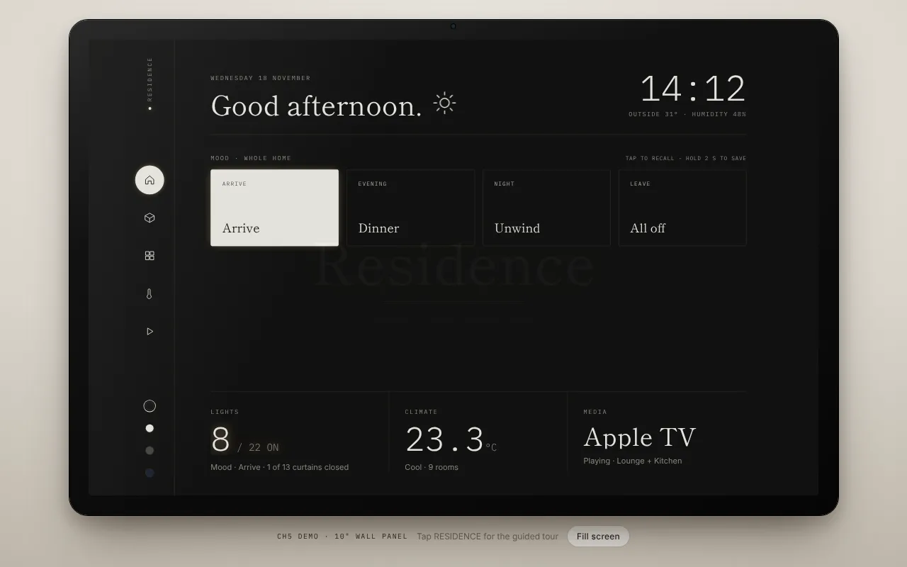
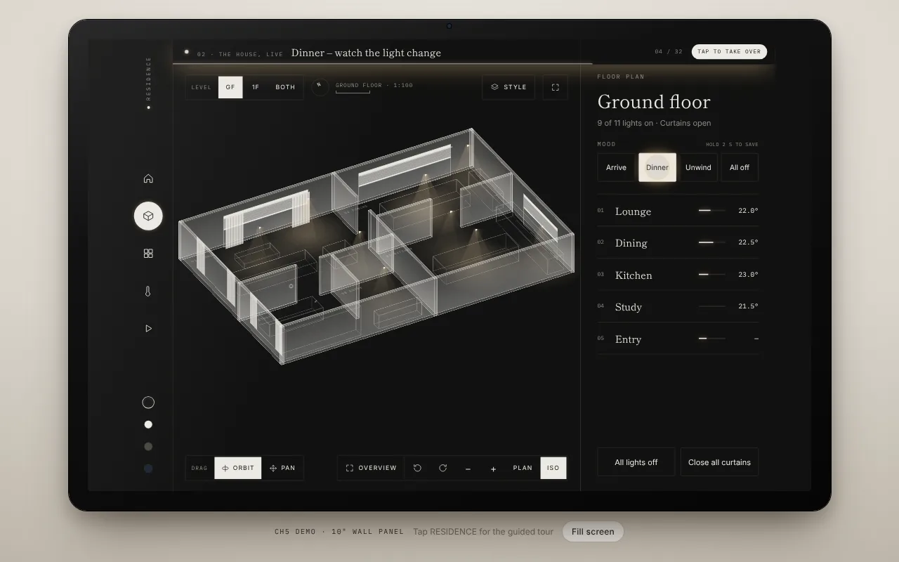
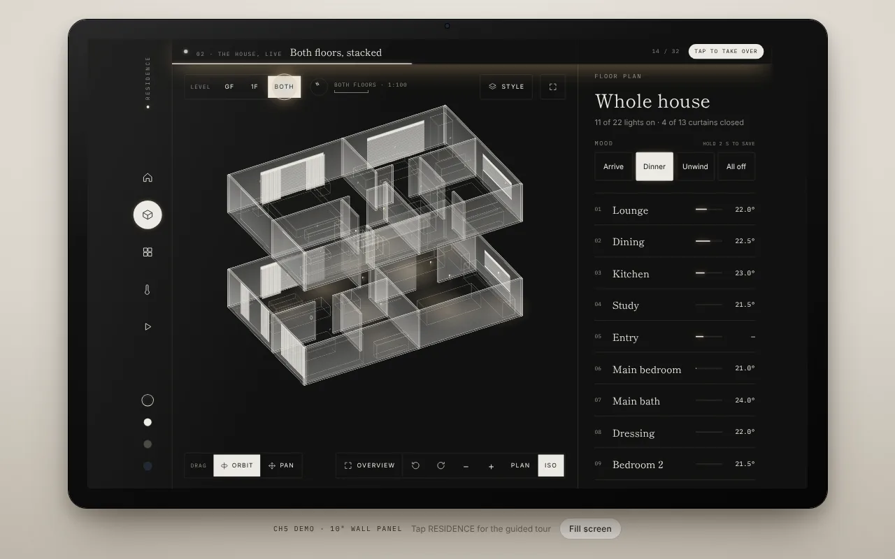
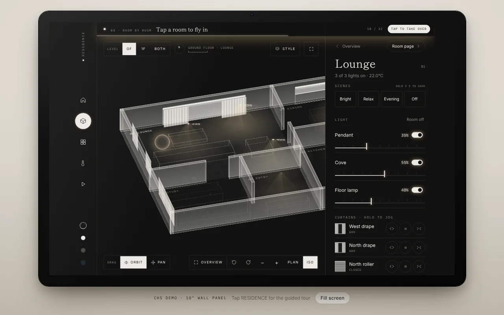

# Quiet Panel

A complete Crestron **CH5** touch-panel interface for a residence, built to show clients what a modern panel can do. On a real installation it runs on a Crestron processor like any CH5 project. For client meetings it has a **built-in demo mode** that simulates the house, so it can be shown in a browser or on a panel before anything is installed.

**Try the demo mode:** open [`SHARE/Residence_Panel_Demo.html`](SHARE/Residence_Panel_Demo.html) in a browser (one self-contained file). Add `?demo=1` to start the guided tour.

| | |
|---|---|
|  |  |
|  |  |

## Why CH5

For years, Crestron touch panels were drawn in **VT Pro-e**: a fixed canvas per panel size, built from the tool's own objects, and a project per screen. **CH5** makes the panel a web app. Crestron Construct still builds CH5 panels from widgets, but underneath it is HTML, CSS and JavaScript — and Quiet Panel is written in that code directly, so anything the browser can do, the panel can do.

| | VT Pro-e (the old way) | CH5, hand-built (this project) |
|---|---|---|
| Built with | Its own design tool and object set | Web code — HTML, CSS, JavaScript, with Crestron's CH5 libraries |
| Screen sizes | One fixed layout per panel size | One project; layout follows the screen (wall panel, iPad, phone) |
| Graphics | Images and built-in objects | Anything the browser can draw: live 3D floor plan, physics, themes |
| Preview | Needs the tool / a panel | Any browser |
| Version control | Binary project files | Plain text — git, diffs, history |
| Client demo | Set up a processor and program on a bench | Built-in demo mode: simulates the house, tours itself |

## What it does

- **Home** — clock, time-of-day greeting, whole-home moods (tap = recall, hold 2 s = save lights + curtains)
- **Floor plan** — wireframe 3D model of two floors; walls Flat / Half / Full; finishes (wire, plaster, concrete, timber, shoji); PLAN / ISO; orbit, pan, pinch, twist; tap a room and the camera flies in
- **Rooms** — scenes, lights, drapes (tap = full travel, hold = jog) and rollers, climate
- **Climate, Media** — ring setpoint with live temperature; sources, transport, volume
- **Three layouts, picked automatically** — landscape (wall panels, iPad landscape), portrait (iPad upright), phone
- **Demo mode** — a "ghost finger" tour in 5 chapters; restarts by itself after 2 min idle (showroom attract mode)

URL options: `?demo=1` · `?theme=Washi|Stone|Aizome` · `?layout=Landscape|Portrait|Phone` · `?ipId=0A` (connect Web XPanel)

## How it's built

```
BUILDER/Main.dc.html   the design (markup, styles, behaviour)
        │  node BUILDER/build_demo.js  (renders it with Preact, ~60-line runtime)
        ▼
SOURCE/                plain web project: index.html + css + js + fonts
        │  python BUILDER/demo_pack.py  (or ch5-cli archive)
        ▼
BUILDS/<date>-vX.Y/Residence_Demo.ch5z   →  touch panel, Crestron One, or a browser
```

To rebuild: `cd BUILDER && npm install && npm run build`, then `python BUILDER/demo_pack.py`.

**Crestron libraries are not included** (Crestron SDK licence). Before packing for a real panel, add them to `SOURCE/js/`:
`cr-com-lib.js` from [`@crestron/ch5-crcomlib`](https://www.npmjs.com/package/@crestron/ch5-crcomlib) and `webxpanel.js` from [`@crestron/ch5-webxpanel`](https://www.npmjs.com/package/@crestron/ch5-webxpanel). The demo-mode file in `SHARE/` doesn't need them.

## Notes

- Touch targets ≥ 40 px; minimum 11 px text on phones; respects reduced motion.
- `CHANGES.txt` has one line per build — v1.0 to v2.5. Several builds *removed* effects (light sweeps, tap ripples, particles) to keep it calm; hence the name.
- This is a demo, not a project template: real projects take their look from the client's designer.

Fonts: Inter, IBM Plex Mono, Shippori Mincho — SIL Open Font License (`SOURCE/fonts/*-LICENSE.txt`). Preact — MIT.

Design and code © Jassim Alfonso. All rights reserved unless a licence is added.
